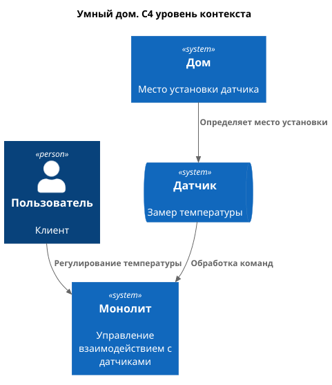
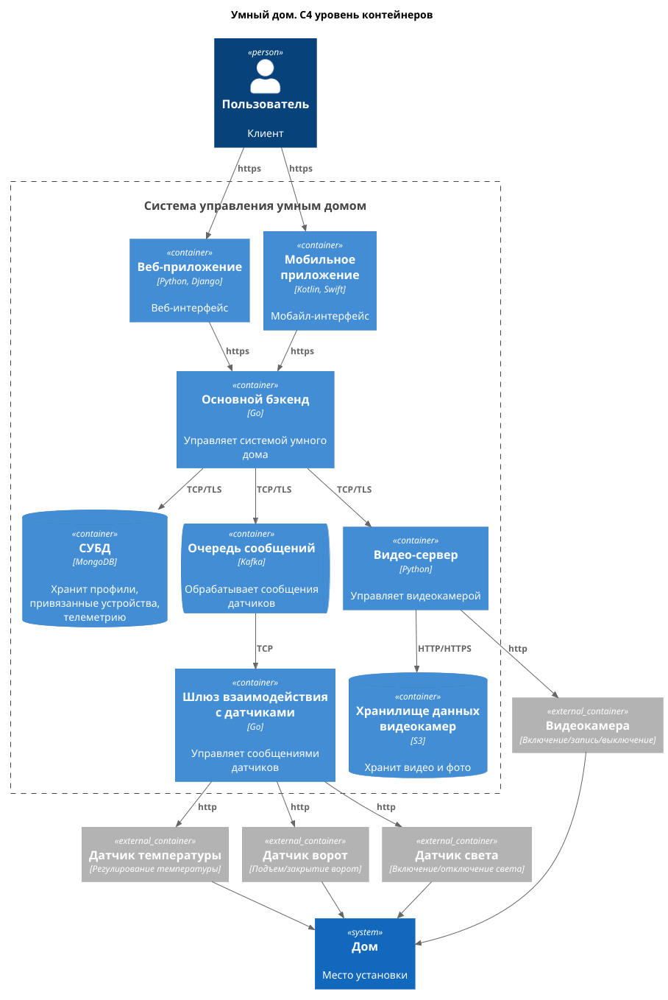
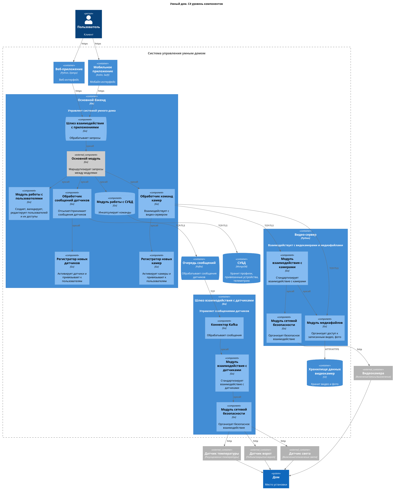
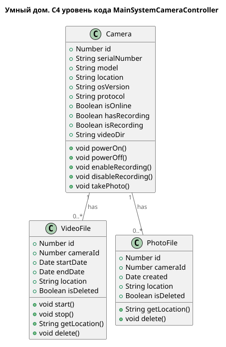
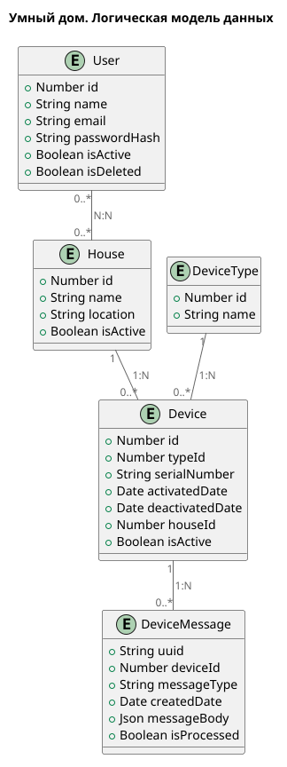

# Задание 1. Анализ и планирование

### 1. Описание функциональности монолитного приложения

**Управление отоплением:**
- Пользователи могут удалённо включать/выключать отопление в своих домах
- Система поддерживает управление отопление запросом к датчику

**Мониторинг температуры:**
- Пользователи могут проверять температуру
- Система поддерживает отображение температуры

### 2. Анализ архитектуры монолитного приложения
Монолитное приложение, язык Go, СУБД PostgreSQL. Обращение из app-уровня в db-уровень синхронное

### 3. Определение доменов и границы контекстов
- Монолитная система (управляет взаимодействием с датчиками - подключение, проверка температуры, включение/выключение отопления)
- Пользователь (посылает запросы на регулирование температуры и отображение текущей температуры)
- Датчик (отвечает на запросы сервера, выставляет по команде сервера температуру)
- Дом (определяет местоположение устройств)

### **4. Проблемы монолитного решения**
- Ручное подключение системы отопления к системе, необходимость выезда мастера - оплата его работы, потеря времени и лояльности клиентов
- Синхронное однопоточное взаимодействие системы с СУБД, одна поломка заденет все последующие
- Получение данных о температуры через посредника - сетевые издержки, отсутствие соединения рушит смысл решения
- Сложность в масштабировании

### 5. Визуализация контекста системы - диаграмма С4

# Задание 2. Проектирование микросервисной архитектуры

**Диаграмма контейнеров (Containers)**

**Диаграмма компонентов (Components)**

**Диаграмма кода (Code)**

# Задание 3. Разработка ER-диаграммы

# Задание 4. Создание и документирование API

### 1. Тип API

Rest-API, все описанные ручки синхронно получают/отдают данные - получить статус, создать новый.

Асинхрон необходим в точке получения метрик от датчиков по мере их работы - то что можно частично потерять

### 2. Документация API

# Задание 5. Работа с docker и docker-compose

Все в папке [5_task](5_task), проверил в Postman, температуру выдает при дергании двух ручек

